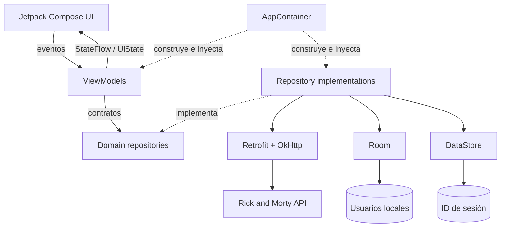

# RickAndMortyApp


Aplicación Android desarrollada como prueba técnica para explorar personajes de
**Rick and Morty**. Combina autenticación local, persistencia de sesión, consumo
de una API REST, búsqueda y filtros, paginación manual y detalle de personajes
con sus episodios.

El proyecto busca demostrar una solución mantenible y verificable sin añadir
complejidad innecesaria: un único módulo `:app`, MVVM, flujo unidireccional de
datos e inyección manual de dependencias.

> Estado actual: autenticación, listado, búsqueda, filtros, refresco, detalle y
> episodios están implementados. Favoritos, episodios vistos y protección
> biométrica todavía están pendientes.

## Índice

- [Presentación](#presentación)
- [Funcionalidades](#funcionalidades)
- [Tecnologías y versiones](#tecnologías-y-versiones)
- [Arquitectura](#arquitectura)
- [Estructura del proyecto](#estructura-del-proyecto)
- [Instalación y ejecución](#instalación-y-ejecución)
- [Seguridad](#seguridad)
- [Pruebas](#pruebas)
- [Capturas de pantalla](#capturas-de-pantalla)
- [Estado respecto a la prueba técnica](#estado-respecto-a-la-prueba-técnica)
- [Decisiones técnicas y limitaciones](#decisiones-técnicas-y-limitaciones)
- [Solución de problemas](#solución-de-problemas)
- [Autor](#autor)

## Presentación

### Objetivo

Ofrecer una experiencia Android moderna para consultar la información pública
de Rick and Morty, aplicando prácticas apropiadas para una prueba técnica:

- UI declarativa con Jetpack Compose y Material 3.
- Separación clara entre presentación, dominio y fuentes de datos.
- Estado observable mediante `StateFlow`.
- Acceso asíncrono a red y almacenamiento local con Coroutines.
- Componentes sustituibles y comprobables mediante pruebas.
- Manejo explícito de carga, contenido, vacío, errores y reintentos.

### API pública

Se utiliza [The Rick and Morty API](https://rickandmortyapi.com/documentation):

```text
https://rickandmortyapi.com/api/
```

La API no requiere clave. La aplicación consume los endpoints de personajes y
episodios, incluyendo la consulta múltiple de episodios para evitar una petición
individual por cada elemento.

## Funcionalidades

### Implementadas y verificadas

#### Autenticación local

- Registro de usuarios mediante Room.
- Nombre de usuario único sin distinguir mayúsculas y minúsculas.
- Normalización Unicode NFKC del nombre de usuario.
- Contraseña mínima de 8 caracteres y campo de confirmación.
- Campos de contraseña ocultos con acción accesible para mostrar u ocultar.
- Inicio de sesión local y mensajes de error.
- Sesión persistente mediante DataStore.
- Validación de que el usuario guardado en la sesión todavía existe.
- Cierre de sesión con diálogo de confirmación.
- Separación de los grafos de navegación autenticado y no autenticado.

#### Listado de personajes

- Carga de personajes desde la API real.
- Paginación manual e incremental con scroll infinito.
- Prevención de peticiones simultáneas y eliminación de duplicados por ID.
- Búsqueda por nombre con `debounce` de 350 ms.
- Filtros por estado: todos, vivo, muerto y desconocido.
- Filtro libre por especie, sin catálogo limitado localmente.
- Combinación y limpieza de filtros.
- Filtros enviados a la API, no aplicados sólo sobre la página local.
- Cancelación o invalidación de consultas obsoletas.
- Pull to refresh conservando los filtros activos.
- Interpretación de un HTTP 404 filtrado como resultado vacío.
- Estados de carga inicial, contenido, vacío, error y paginación.
- Conservación del contenido ante un error de página adicional.
- Buscador fijo y panel de filtros dinámico según la dirección del scroll.
- Cierre de sesión accesible desde el encabezado.

#### Detalle y episodios

- Navegación al detalle pasando únicamente el ID del personaje.
- Imagen ampliada, nombre, género, especie, estado, origen y última ubicación.
- Estado expresado mediante texto y color.
- Consulta y presentación del nombre y código de los episodios.
- Endpoint individual para un episodio y endpoint múltiple para varios.
- Conservación del orden original de los episodios.
- Errores de episodios independientes: la información del personaje permanece
  disponible y el usuario puede reintentar.
- Regreso al listado conservando búsqueda, filtros y posición de scroll.
- Estados de carga, contenido, vacío, error y reintento.

#### Experiencia de usuario

- Diseño adaptable basado en Material 3.
- Tema claro y oscuro mediante colores semánticos.
- Identidad visual sutil inspirada en portales y ciencia ficción.
- Textos visibles almacenados en recursos.
- Etiquetas accesibles para imágenes y acciones relevantes.
- Previews de Compose para estados representativos.

### Pendientes

- Marcar y desmarcar personajes favoritos por usuario.
- Pantalla de favoritos persistentes.
- Marcar episodios como vistos por usuario.
- Protección biométrica del acceso a favoritos.
- Flujo integral final que reúna todos los requisitos anteriores.

No se incluyen Hilt, Paging 3 ni una base de datos cifrada con SQLCipher en el
estado actual del proyecto.

## Tecnologías y versiones

Las versiones siguientes proceden de la configuración actual del proyecto y de
`gradle/libs.versions.toml`.

| Tecnología | Versión/configuración | Uso |
|---|---:|---|
| Kotlin | 2.2.10 | Lenguaje principal y plugins de Compose/Serialization |
| Android Gradle Plugin | 9.3.3 | Construcción del módulo Android |
| Gradle Wrapper | 9.5.0 | Automatización de compilación |
| Java | compatibilidad de código 11 | `sourceCompatibility` y `targetCompatibility` |
| Android SDK | compileSdk 36.1, targetSdk 36, minSdk 26 | Plataforma de compilación y compatibilidad |
| Jetpack Compose | BOM 2026.02.01 | UI declarativa, tooling y pruebas Compose |
| Material 3 | administrado por Compose BOM | Componentes, temas y pull to refresh |
| Lifecycle Runtime/ViewModel Compose | 2.6.1 | Ciclo de vida, ViewModels y recogida de estado |
| Coroutines / StateFlow | API de Kotlin Coroutines; Coroutines Test 1.10.2 | Concurrencia, cancelación y estado observable |
| Retrofit | 3.0.0 | Cliente REST tipado |
| OkHttp | 5.1.0 | Transporte HTTP y MockWebServer |
| Kotlin Serialization JSON | 1.9.0 | Deserialización de respuestas JSON |
| Coil Compose | 3.3.0 | Carga de imágenes en Compose |
| Room | 2.8.5 | Persistencia de usuarios locales |
| DataStore Preferences | 1.3.0 | Persistencia del ID de la sesión activa |
| Navigation Compose | 2.9.8 | Flujos de autenticación, listado y detalle |
| KSP | 2.3.14 | Generación de código de Room |
| JUnit | 4.13.2 | Pruebas unitarias |
| AndroidX Test JUnit | 1.1.5 | Pruebas instrumentadas |
| Espresso Core | 3.5.1 | Infraestructura de pruebas Android |

## Arquitectura

La aplicación sigue MVVM con una separación ligera en capas. Los contratos del
dominio no exponen Retrofit, DTO, Room ni componentes de Android.



### Responsabilidades

| Capa | Responsabilidad |
|---|---|
| `ui` | Composables, estados de pantalla, ViewModels, eventos y factories |
| `domain` | Modelos, contratos de Repository y abstracciones de seguridad |
| `data` | DTO, mappers, Retrofit, Room, DataStore, hash y Repositories concretos |
| `navigation` | Destinos y grafos protegidos por el estado de sesión |
| `app` | Construcción manual de dependencias mediante `AppContainer` |

### Flujo de datos

1. Un composable emite una acción del usuario.
2. El ViewModel actualiza o inicia una operación dentro de `viewModelScope`.
3. El Repository accede a Retrofit, Room o DataStore según corresponda.
4. DTO y entidades se transforman en modelos de dominio.
5. El ViewModel publica un `UiState` inmutable mediante `StateFlow`.
6. Compose observa el estado con `collectAsStateWithLifecycle()` y redibuja la UI.

### Justificación

- **MVVM y StateFlow:** separan el estado y las operaciones de la representación.
- **Repository:** evita acoplar ViewModels a Retrofit, Room o DataStore y facilita
  el uso de implementaciones falsas en pruebas.
- **AppContainer:** aporta inyección explícita y suficiente para el tamaño de la
  prueba, sin incorporar un framework adicional.
- **Paginación manual:** permite controlar explícitamente las solicitudes, la cancelación y la acumulación de páginas sin añadir Paging 3.
- **Un único módulo:** mantiene tiempos de navegación y revisión razonables para
  una prueba técnica, conservando límites por paquetes.

## Estructura del proyecto

```text
app/src/main/java/com/example/rickandmorty/
├── app/
│   └── AppContainer.kt
├── data/
│   ├── local/
│   │   ├── database/
│   │   ├── session/
│   │   └── user/
│   ├── remote/
│   │   ├── dto/
│   │   ├── mapper/
│   │   └── serialization/
│   ├── repository/
│   └── security/
├── domain/
│   ├── model/
│   ├── repository/
│   └── security/
├── navigation/
├── ui/
│   ├── auth/
│   ├── characters/
│   │   ├── components/
│   │   └── detail/
│   ├── session/
│   └── theme/
└── MainActivity.kt
```

Los tests reproducen la estructura de paquetes bajo `app/src/test` y
`app/src/androidTest`. El esquema exportado de Room se conserva en
`app/schemas`.

## Instalación y ejecución

### Requisitos

- Git.
- Android Studio compatible con AGP 9.3.3 y Gradle 9.5.0.
- JDK compatible con Gradle 9.5.0 (JDK 17 o posterior, según los requisitos de las herramientas de compilación). El código
  fuente del módulo mantiene compatibilidad Java 11.
- Android SDK 36 con minor API level 1 instalado.
- Emulador o dispositivo con Android 8.0 / API 26 como mínimo.
- Conexión a Internet para descargar dependencias y consultar la API.

No es necesario configurar una API key ni añadir secretos locales.

### Clonar y seleccionar la rama

```bash
git clone https://github.com/papivrgs/rick-and-morty-android.git
cd rick-and-morty-android
git switch feature/characters
```

### Abrir en Android Studio

1. Seleccionar **Open** y abrir la carpeta raíz del repositorio.
2. Confirmar el JDK de Gradle en **Settings > Build Tools > Gradle**.
3. Instalar el SDK solicitado si Android Studio lo indica.
4. Esperar a que finalice **Sync Project with Gradle Files**.
5. Crear o seleccionar un emulador API 26 o superior, o conectar un dispositivo
   físico con depuración USB habilitada.
6. Seleccionar la configuración `app` y pulsar **Run**.

### Compilar desde terminal

Windows PowerShell:

```powershell
.\gradlew.bat :app:assembleDebug
```

Linux o macOS:

```bash
./gradlew :app:assembleDebug
```

El APK se genera en:

```text
app/build/outputs/apk/debug/app-debug.apk
```

Instalación opcional mediante ADB:

```bash
adb install -r app/build/outputs/apk/debug/app-debug.apk
```

### Primer acceso

1. Abrir la aplicación y seleccionar **Crear una cuenta**.
2. Introducir un nombre de usuario todavía no registrado.
3. Introducir una contraseña de al menos 8 caracteres y confirmarla.
4. Completar el registro y regresar al login.
5. Iniciar sesión con las credenciales registradas para acceder al listado.
6. En futuros inicios, DataStore restaura la sesión si el usuario continúa
   existiendo en Room.
7. Para probar otro usuario, utilizar el icono de cierre de sesión y confirmar.

Los usuarios pertenecen únicamente a la instalación local de la aplicación; no
se crean cuentas en un servidor externo.

## Seguridad

### Medidas implementadas

| Medida | Implementación real |
|---|---|
| Almacenamiento de contraseña | Nunca se persiste en texto plano |
| Algoritmo | `PBKDF2WithHmacSHA256` |
| Iteraciones | 210.000 por defecto; el valor se guarda con cada usuario |
| Salt | 16 bytes generados individualmente con `SecureRandom` |
| Longitud derivada | 256 bits |
| Comparación | `MessageDigest.isEqual` para comparación segura de bytes |
| Higiene en memoria | Uso temporal de `CharArray` y limpieza posterior |
| Unicidad de usuario | Índice único de Room sobre el nombre normalizado |
| Sesión | DataStore guarda únicamente el ID del usuario autenticado |
| Validación de sesión | El ID se contrasta con Room; una referencia huérfana se elimina |
| Cierre de sesión | Elimina el ID de DataStore y vuelve al flujo no autenticado |
| Navegación protegida | El grafo de listado/detalle sólo se crea con sesión válida |
| Respaldos | Base de datos y carpeta de DataStore excluidas de backup y transferencia |

Aunque `android:allowBackup` permanece habilitado, `backup_rules.xml` y
`data_extraction_rules.xml` excluyen explícitamente la base de datos y la sesión
tanto de copias en la nube como de transferencia entre dispositivos.

### Limitaciones

- La autenticación es local: no proporciona identidad remota, recuperación de
  contraseña, sincronización ni segundo factor.
- Room no utiliza SQLCipher; el hash protege las contraseñas, pero la base de
  datos completa no está cifrada por la aplicación.
- La seguridad sigue dependiendo de las protecciones del sistema Android y del
  dispositivo. Un dispositivo comprometido queda fuera del alcance.
- Al desinstalar o borrar los datos se eliminan usuarios y sesión.
- La biometría todavía no está implementada.

## Pruebas

### Estrategia disponible

- **Pruebas unitarias:** DTO y serialización, mappers, Repositories, hash de
  contraseñas y ViewModels.
- **MockWebServer:** respuestas HTTP válidas, errores, JSON inválido, parámetros,
  filtros, detalle y consulta múltiple de episodios.
- **Coroutines Test:** debounce, cancelación, paginación y transiciones de estado.
- **Room instrumentado:** DAO y restricciones de usuarios sobre una base local de
  prueba.
- **Compose UI Test:** autenticación, estados del listado, filtros, refresco,
  detalle, reintentos y acciones accesibles.
- **Navegación instrumentada:** apertura del detalle por ID y regreso conservando
  búsqueda y posición.

### Resultados verificados disponibles

La última validación selectiva registrada para la Etapa 9 finalizó con:

| Conjunto ejecutado | Resultado |
|---|---:|
| Pruebas unitarias nuevas y directamente afectadas | 45 aprobadas, 0 fallidas |
| Pruebas instrumentadas de detalle y navegación | 6 aprobadas, 0 fallidas |
| `assembleDebug` | Correcto |

Estos valores corresponden a una ejecución selectiva, no a una afirmación sobre
la cantidad total de tests del repositorio. Las suites completas y lint deben
volver a ejecutarse antes de la entrega final.

### Comandos en Windows

```powershell
# Unitarias
.\gradlew.bat :app:testDebugUnitTest

# Instrumentadas: requiere dispositivo o emulador conectado
.\gradlew.bat :app:connectedDebugAndroidTest

# Análisis estático
.\gradlew.bat :app:lintDebug
```

Ejemplo de filtro unitario:

```powershell
.\gradlew.bat :app:testDebugUnitTest --tests "com.example.rickandmorty.ui.characters.detail.CharacterDetailViewModelTest"
```

### Comandos en Linux y macOS

```bash
# Unitarias
./gradlew :app:testDebugUnitTest

# Instrumentadas: requiere dispositivo o emulador conectado
./gradlew :app:connectedDebugAndroidTest

# Análisis estático
./gradlew :app:lintDebug
```

## Capturas de pantalla

Las capturas definitivas todavía no están incorporadas al repositorio. Se propone almacenarlas en `docs/screenshots/` con la
siguiente convención. Las imágenes no se enlazan todavía para evitar referencias
rotas mientras no existan los archivos.

```text
docs/screenshots/
├── 01-login-light.png
├── 02-register-light.png
├── 03-character-list.png
├── 04-search-filters.png
├── 05-character-detail.png
├── 06-episodes.png
└── 07-dark-theme.png
```

| Captura prevista | Contenido recomendado | Estado |
|---|---|---|
| Login | Formulario y acción para crear cuenta | Pendiente de capturar |
| Registro | Campos, confirmación y visibilidad de contraseña | Pendiente de capturar |
| Listado | Encabezado, tarjetas y paginación | Pendiente de capturar |
| Búsqueda y filtros | Consulta combinada y filtros activos | Pendiente de capturar |
| Detalle | Imagen e información general del personaje | Pendiente de capturar |
| Episodios | Código y nombre de varios episodios | Pendiente de capturar |
| Tema oscuro | Una pantalla representativa en modo oscuro | Pendiente de capturar |

Para mantener consistencia, conviene usar el mismo dispositivo, resolución y
escala de fuente, ocultar datos de prueba innecesarios y capturar estados con
contenido real estable.

## Estado respecto a la prueba técnica

**Referencia de implementación:** commit `9123006` en la rama `feature/characters` (Etapa 9). Esta versión es funcional, pero la prueba técnica todavía presenta requisitos obligatorios pendientes.

La siguiente matriz refleja los cinco requisitos funcionales recogidos en el
documento original. No se consideran terminadas las partes aún no presentes en
el código.

| # | Requisito funcional | Estado | Evidencia actual | Trabajo pendiente |
|---:|---|---|---|---|
| 1 | Login local, manejo de errores y creación de usuarios con Room | Implementado | Room, PBKDF2, DataStore, Login/Register, sesión y logout | Regresión integral final |
| 2 | Listado con paginación, filtros, búsqueda, datos, pull to refresh y estados | Implementado | Retrofit, paginación manual, filtros API, debounce, refresh y estados Compose | Regresión integral final |
| 3 | Detalle, episodios, favoritos y episodios vistos | Parcial | Detalle y episodios están implementados y probados | Favoritos y episodios vistos |
| 4 | Pantalla de favoritos | Pendiente | No existen entidades, Repository, ViewModel ni pantalla de favoritos | Implementación completa |
| 5 | Acceso biométrico a favoritos | Pendiente | No existe dependencia ni integración biométrica | Implementación después de favoritos |

### Requisitos generales y calidad

| Criterio | Estado |
|---|---|
| Aplicación Android nativa con Kotlin y API externa | Implementado |
| Arquitectura MVVM | Implementado |
| Repositorio GitHub | Publicado en `feature/characters` |
| Instrucciones de ejecución | Documentadas en este README |
| Dagger Hilt (deseable) | No incorporado; se utiliza inyección manual |
| Pruebas unitarias e instrumentadas (deseable) | Implementadas; regresión integral pendiente |
| Múltiples tamaños de pantalla y orientación (deseable) | Diseño adaptable; validación integral pendiente |

## Decisiones técnicas y limitaciones

- La API se consume directamente, sin backend propio ni API key.
- `ignoreUnknownKeys = true` permite tolerar nuevos campos remotos sin ocultar la
  ausencia de campos obligatorios en los DTO.
- Las cancelaciones de corrutinas se propagan y no se convierten en errores de
  conexión o serialización.
- Las búsquedas obsoletas no pueden sobrescribir una consulta más reciente.
- La consulta múltiple de episodios reduce el número de peticiones y conserva el
  orden solicitado.
- No existe caché offline de personajes; la persistencia local actual se limita
  a usuarios y sesión.
- No se han incorporado Hilt, Paging 3, Room para personajes ni modularización
  múltiple porque no son necesarios para el alcance implementado.

## Solución de problemas

| Situación | Acción recomendada |
|---|---|
| Gradle no sincroniza | Revisar el JDK configurado, el SDK requerido y la conexión a Internet. |
| No aparece un dispositivo | Iniciar un emulador o comprobar la conexión con `adb devices`. |
| No se muestran personajes | Comprobar la conexión a Internet y utilizar la acción de reintento. |
| No hay resultados de búsqueda | Limpiar los filtros o probar otro nombre o especie. |
| Credenciales incorrectas | Verificar el usuario y la contraseña; si es necesario, registrar otra cuenta local. |
| Advertencia LF/CRLF en Windows | Es una advertencia de conversión de saltos de línea de Git, no un fallo de compilación. |

## Autor

**Alexis Martínez Sánchez**

Repositorio: [github.com/papivrgs/rick-and-morty-android](https://github.com/papivrgs/rick-and-morty-android)
